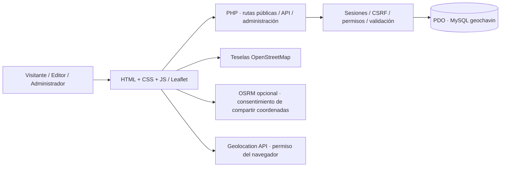
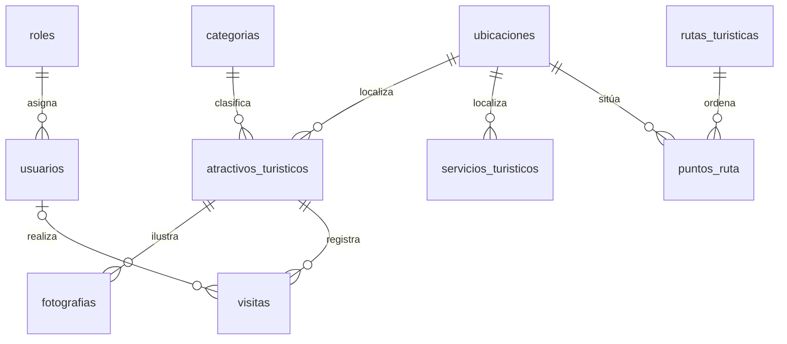

# GeoChavín · análisis y diseño previo

## Objetivo y alcance
Plataforma turística del distrito de Chavín de Huántar, Huari, Áncash, Perú. Visitantes consultan inventario, fotografías, mapa, GPS, rutas, directorio e historia. Editores mantienen contenido; administradores gestionan usuarios y reportes. No se simulan servicios, fotografías ni coordenadas. Un registro pendiente aparece identificado y no se representa como geografía comprobada.

## Arquitectura
PHP 8.2+ sin framework ni dependencias Composer; HTML semántico, CSS responsive y JavaScript modular. Front controller `public/index.php`, vistas y utilidades en `app`, PDO/MySQL en servidor. Leaflet 1.9.4 local, teselas OpenStreetMap. Enrutamiento opcional mediante OSRM configurado: no confundir una línea recta con ruta real. XAMPP (Apache/PHP/MariaDB) y Docker (PHP/MySQL 8.4) son alternativas. MySQL sigue siendo la persistencia real; no hay almacenamiento local que sustituya la base de datos.

## Modelo entidad-relación

Coordenadas WGS84 `DECIMAL(10,7)`/`DECIMAL(11,7)`, nunca 0 como sustituto de desconocido. `POINT` es una columna generada a partir de longitud/latitud, opcional en consultas y sin SRID específico para compatibilidad MariaDB/XAMPP. Orden POINT(lon,lat). Índices B-tree en claves, búsquedas y estado; UNIQUE en correo, nombres de roles y orden de puntos. Para operaciones espaciales avanzadas, una migración MySQL específica puede añadir SRID 4326 e índice SPATIAL NOT NULL. No calcular metros con ST_Distance sobre grados.

## Diseño UX/UI
Verde bosque #173e32, marrón #674934, dorado #d5ac60, blanco marfil #f7f5ef. Tipografía de sistema y serif editorial. Cabecera accesible, hero ilustrado (no fotografía documental), buscador, categorías, mapa y tarjetas de inventario. Fichas con verificación, referencia, galería atribuida y posición solo cuando esté comprobada. Estados vacíos informativos, sin inventario ficticio. Vista móvil, navegación por teclado, foco visible, contraste, mensajes aria-live y respeto de movimiento reducido.

## Flujos y permisos
Público: inicio → búsqueda / categorías → ficha → mapa / GPS / ruta; directorio, historia, rutas.
Editor: login → CRUD inventario, categorías, ubicaciones, fotos, servicios, rutas y puntos.
Administrador: todo lo anterior + usuarios + reportes agregados y CSV.
Las visitas son conteos de visualización deduplicados por sesión y día; no representan visitantes únicos ni estadísticas oficiales.

## Seguridad
PDO con parámetros y emulación desactivada; identificadores SQL de lista cerrada. Escape HTML, CSRF para mutaciones, sesiones HttpOnly/SameSite, renovación al autenticar, password_hash/verify, roles comprobados en servidor, rate limit por sesión e IP con hashes temporales fuera de public; no registrar GPS. Validación de límites coordenados y territorio declarado por operador; verificación editorial requiere fuente HTTPS. No se convierte automáticamente una fuente en hecho comprobado. Fotos mediante URL HTTPS con atribución, sin descargas de servidor. Contraseñas fuera del código. Gestión de usuarios evita eliminar/desactivar/degradar la propia cuenta y protege al último administrador activo. Cabeceras CSP y políticas de navegador. Producción exige HTTPS, respaldos y credenciales limitadas.

## Datos y fuentes
Referencia inicial: «Chavín (Archaeological Site)», UNESCO, https://whc.unesco.org/en/list/330/. La red de esta sesión no permite consultar este dominio; se conserva pendiente de cotejo, sin coordenadas ni fotos. No es un inventario oficial completo. MINCETUR y Ministerio de Cultura son fuentes propuestas para revisión futura; el operador debe comprobar nombre, jurisdicción, precisión de coordenadas, permisos fotográficos, accesos y horarios antes de marcar datos verificados. No se muestran horarios o precios inventados.

## Estructura
`database/schema.sql`, `app/{bootstrap,helpers,admin,views}.php`, `public/{index.php,router.php,assets}`, `bin/{install.php,create-admin.php}`, `tests/smoke.py`, `docs`, `Dockerfile`, `compose.yaml`. El script SQL completo se define antes de los módulos; el panel es metadatos de lista cerrada con validación por campo.
